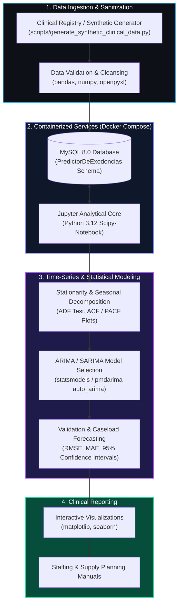

# Containerized Clinical Research & Epidemiological Time-Series Platform

[](https://opensource.org/licenses/MIT)
[](https://python.org)
[](https://docker.com)
[](https://mysql.com)
[](https://jupyter.org)
[](https://www.statsmodels.org/)

A reproducible, containerized analytical environment for clinical research, epidemiological time-series forecasting, and surgical caseload modeling using **Python 3.12**, **MySQL 8.0**, **Docker**, **ARIMA/SARIMA** (`statsmodels`/`pmdarima`), and **scikit-learn**.

---

## 1. Overview & Clinical Context

In hospital and community health settings, surgical procedure demand (such as emergency exodontia and oral surgery) exhibits complex temporal dynamics: seasonal flu/holiday variations, weekly triage spikes, and multi-year demographic trends. Accurate caseload forecasting is vital for surgical suite staffing, consumable inventory procurement, and reducing patient wait times.

This platform provides an isolated, portable, and reproducible infrastructure designed to:
- Ingest and normalize longitudinal clinical encounter registries into a structured MySQL 8.0 database.
- Perform exploratory data analysis (EDA), stationarity tests (Augmented Dickey-Fuller), and seasonal decomposition.
- Train, evaluate, and benchmark **ARIMA** (Autoregressive Integrated Moving Average) and **SARIMA** (Seasonal ARIMA) models alongside supervised regression baselines.
- Maintain an air-gapped environment ensuring zero inadvertent transmission of sensitive patient records.

---

## 2. Platform Architecture & Data Pipeline



---

## 3. Technology Stack

- **Containerization:** Docker & Docker Compose orchestrating isolated multi-container services.
- **Analytical Engine:** Jupyter Scipy Notebook running Python 3.12.
- **Relational Backend:** MySQL 8.0 container with persistent volume mounts and automated initialization.
- **Statistical & ML Libraries:** `statsmodels`, `pmdarima`, `scikit-learn`, `pandas`, `numpy`.
- **Visualization:** `matplotlib`, `seaborn`.
- **Data Exchange:** `mysql-connector-python`, `openpyxl`, `xlrd`.

---

## 4. Quickstart

### Prerequisites
- [Docker](https://docs.docker.com/get-docker/) & Docker Compose
- Python 3.10+ (for local synthetic generation and pytest validation)

### 1. Clone & Configure Environment
```bash
git clone https://github.com/DrCiroSmith/internado-investigacion.git
cd internado-investigacion

# Copy sample configuration
cp .env.example .env
```

### 2. Generate Synthetic Clinical Dataset
To explore the analytical pipeline without real patient data, generate a realistic 104-week synthetic clinical time-series:
```bash
python3 scripts/generate_synthetic_clinical_data.py --weeks 104 --output data/synthetic_clinical_timeseries.csv
```

### 3. Launch Containerized Environment
```bash
docker compose up -d
```
Access Jupyter Notebook at `http://localhost:8888`.

### 4. Run Test Suite
```bash
pytest tests/ -v
```

---

## 5. Repository Structure

```
internado-investigacion/
├── docker/
│   └── Dockerfile           # Jupyter analytical image with clinical ML dependencies
├── scripts/
│   └── generate_synthetic_clinical_data.py # Reproducible synthetic dataset generator
├── tests/
│   └── test_pipeline.py     # Smoke tests and mathematical validation
├── docker-compose.yml       # Multi-container orchestration (Jupyter + MySQL)
├── GUÍA_USO.md              # Detailed step-by-step clinical methodology (Spanish)
├── .env.example             # Configuration template
├── .gitignore               # Strict exclusion of patient spreadsheets and DB volumes
└── README.md                # Platform documentation
```

---

## 6. Privacy & Zero-PHI Architecture

- **Air-Gapped by Design:** Docker network binds only to localhost ports for development.
- **Strict `.gitignore`:** All Excel (`.xlsx`, `.xls`), raw text, and CSV files placed in `data/` or `forms/` are automatically excluded from version control.
- **Synthetic Demonstration Default:** Synthetic dataset generators ensure full pipeline reproducibility with zero exposure of identifiable clinical records.

---
---

# 🇪🇸 Documentación en Español

### Ecosistema portátil y seguro para análisis clínico con Jupyter, Python 3.12, MySQL 8.0 y Docker.

## 🔄 Flujo de Trabajo Clínico

1. **Clonar el repositorio:** `git clone https://github.com/DrCiroSmith/internado-investigacion.git`
2. **Configurar credenciales:** Copiar `.env.example` a `.env`.
3. **Generar o cargar datos:** Ejecutar el generador sintético o colocar hojas de cálculo anonimizadas en `data/`.
4. **Levantar el entorno:** `docker compose up -d`
5. **Acceder a Jupyter Notebook:** Ingresar a `http://localhost:8888` para explorar los datos.
6. **Almacenar en MySQL:** Cargar datos limpios y normalizados al esquema de base de datos.
7. **Modelado Predictivo:** Entrenar y evaluar modelos **ARIMA / SARIMA** para proyección de demanda quirúrgica.
8. **Documentar y sincronizar:** Guardar notebooks con gráficos y métricas de desempeño.

Consulta **[GUÍA_USO.md](./GUÍA_USO.md)** para la guía paso a paso detallada sobre importación de datos y entrenamiento de modelos.

---

## Author / Autor

**Dr. Roi Castrellon, DDS**  
Clinical AI & Healthcare Data Engineering  
GitHub: [@DrCiroSmith](https://github.com/DrCiroSmith)
