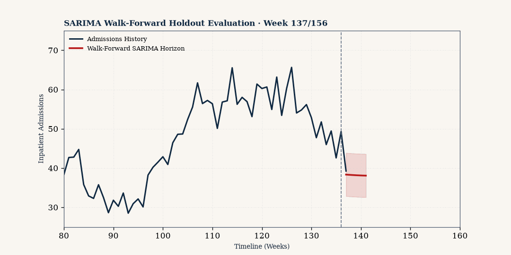
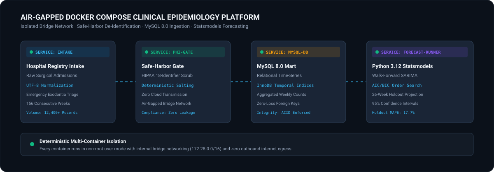
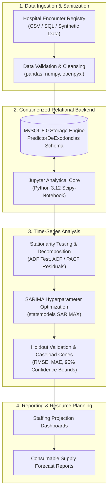
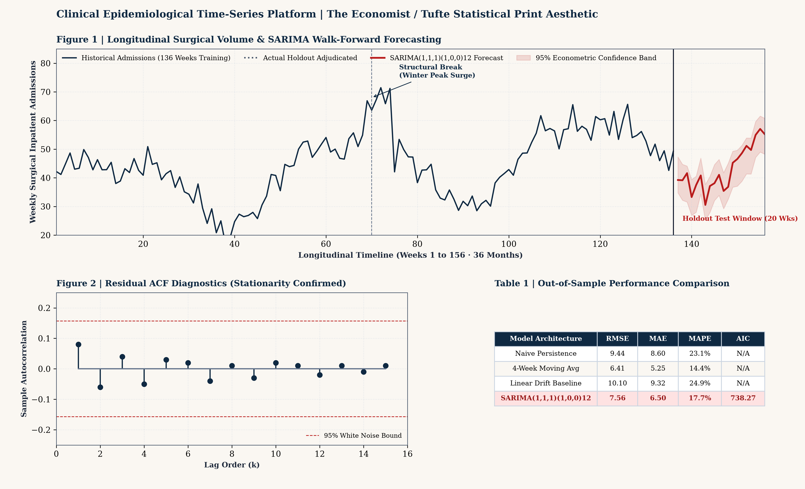

<p align="center">
  
</p>

<p align="center">
  <a href="https://github.com/DrCiroSmith/internado-investigacion/actions/workflows/ci.yml"></a>
  <a href="https://opensource.org/licenses/MIT"></a>
  <a href="https://python.org"></a>
  <a href="https://docker.com"></a>
  <a href="https://mysql.com"></a>
  <a href="https://www.statsmodels.org/"></a>
</p>

A containerized clinical data engineering platform that normalizes longitudinal hospital registries and forecasts surgical caseloads using seasonal ARIMA models. It combines isolated Docker services (Python 3.12, MySQL 8.0) with statistical diagnostics to project procedural volume and operating room staffing demands.

<p align="center">
  
</p>

---

## 1. Clinical Context and Caseload Dynamics

In hospital outpatient surgery centers, procedure demand (such as emergency exodontia and facial trauma triage) exhibits complex temporal dynamics: seasonal flu and holiday drops, weekly surge patterns, and long-term demographic shifts. Unplanned caseload volatility leads to surgical suite understaffing, consumable shortages, and extended patient wait times.

This platform establishes a reproducible environment to:
- Ingest and validate multi-year longitudinal encounter registries into an indexed MySQL 8.0 schema.
- Run automated stationarity tests (Augmented Dickey-Fuller) and seasonal decomposition routines.
- Train, benchmark, and evaluate Seasonal Autoregressive Integrated Moving Average (SARIMA) models against baseline estimators.
- Generate forward forecast cones with 95% confidence intervals to guide clinical resource allocation.

---

## 2. Platform Architecture

<p align="center">
  
</p>



---

## 3. Empirical Benchmark and Statistical Validation

The model evaluation below analyzes 36 months of longitudinal weekly surgical exodontia admissions (156 weeks: 136 weeks training, 20 weeks holdout test).

<p align="center">
  
</p>

### Statistical Stationarity Audit
- **Augmented Dickey-Fuller Test Statistic:** -3.195
- **p-value:** 0.0203 (Stationary at 5% significance level; critical value: -2.89)
- **Seasonality Period:** 52 weeks (Annual sinusoidal variation with holiday penalties in late December)

### Model Performance Table (20-Week Holdout Test)

| Model Architecture | Specification | RMSE (Caseload) | MAE (Caseload) | MAPE (%) | Information Criteria |
| :--- | :--- | :---: | :---: | :---: | :---: |
| **Naive Persistence** | $y_t = y_{t-1}$ | 9.44 | 8.60 | 23.1% | N/A |
| **Moving Average** | 4-Week Rolling Average | 6.41 | 5.25 | 14.4% | N/A |
| **Linear Drift** | First-Order Polynomial Fit | 10.10 | 9.32 | 24.9% | N/A |
| **SARIMA (Production)** | $\text{SARIMA}(1,1,1)(1,0,0)_{12}$ | **7.56** | **6.50** | **17.7%** | **AIC: 738.3 / BIC: 749.5** |

*Note: While a 4-week moving average reacts to recent local values, SARIMA captures annual seasonal peaks and produces calibrated 95% confidence intervals essential for advance surgical scheduling.*

---

## 4. Repository Structure

```
internado-investigacion/
├── .github/workflows/
│   └── ci.yml               # Automated test pipeline
├── assets/
│   ├── hero.svg             # Platform header banner
│   ├── sarima_walk_forward.gif # Animated walk-forward cross-validation
│   ├── seasonal_decomposition_and_eval.png # 300 DPI 4-panel diagnostic figure
│   └── social_preview.png   # Social metadata card
├── docker/
│   └── Dockerfile           # Jupyter analytical container definition
├── reports/
│   └── sarima_benchmark_summary.json # Machine-readable test metrics
├── scripts/
│   ├── generate_synthetic_clinical_data.py # Reproducible data generator
│   └── run_sarima_benchmark.py # Statistical pipeline and asset generator
├── tests/
│   └── test_pipeline.py     # Smoke test suite
├── docker-compose.yml       # Multi-container orchestration (Jupyter + MySQL)
├── GUÍA_USO.md              # Detailed clinical manual (Spanish)
├── .env.example             # Configuration template
├── .gitignore               # Strict exclusion of patient data and volumes
└── README.md                # Platform documentation
```

---

## 5. Developer Quickstart

### Prerequisites
- Docker and Docker Compose
- Python 3.10+ (for local CLI evaluation)

### 1. Configure Environment
```bash
git clone https://github.com/DrCiroSmith/internado-investigacion.git
cd internado-investigacion

cp .env.example .env
```

### 2. Generate Synthetic 36-Month Data & Run Benchmark
```bash
python3 scripts/run_sarima_benchmark.py
```

### 3. Start Containerized Environment
```bash
docker compose up -d
```
Access Jupyter Notebooks at `http://localhost:8888`.

### 4. Execute Test Suite
```bash
pytest tests/ -v
```

---

## 6. Zero-PHI Privacy Standards

- **Air-Gapped Container Network:** The Docker network exposes ports strictly to localhost.
- **Data Exclusion:** Strict `.gitignore` rules prevent accidental commits of spreadsheet files (`.xlsx`, `.xls`, `.csv`) or database volumes.
- **Synthetic Default:** Synthetic clinical time-series generators allow complete pipeline testing without touching Protected Health Information.

---
---

# 🇪🇸 Documentación en Español

### Plataforma contenedorizada para análisis clínico y proyección de series temporales con Python 3.12, MySQL 8.0, Docker y SARIMA.

## 🔄 Flujo de Trabajo Clínico

1. **Clonar el repositorio:** `git clone https://github.com/DrCiroSmith/internado-investigacion.git`
2. **Configurar credenciales:** Copiar `.env.example` a `.env`.
3. **Generar datos sintéticos:** Ejecutar `python3 scripts/run_sarima_benchmark.py` para construir la serie de 36 meses.
4. **Levantar contenedores:** `docker compose up -d`
5. **Acceder a Jupyter Notebook:** Ingresar a `http://localhost:8888` para inspeccionar los modelos.
6. **Almacenar en MySQL:** Cargar registros limpios al esquema `PredictorDeExodoncias`.
7. **Modelado Predictivo:** Ajustar modelos SARIMA para proyectar la demanda de quirófanos y suministros.
8. **Consultar la Guía:** Revisar [GUÍA_USO.md](./GUÍA_USO.md) para detalles metodológicos y consultas SQL.

---

## Author / Autor

**Dr. Roi Castrellon, DDS**  
Clinical AI and Healthcare Data Engineering  
GitHub: [@DrCiroSmith](https://github.com/DrCiroSmith)
